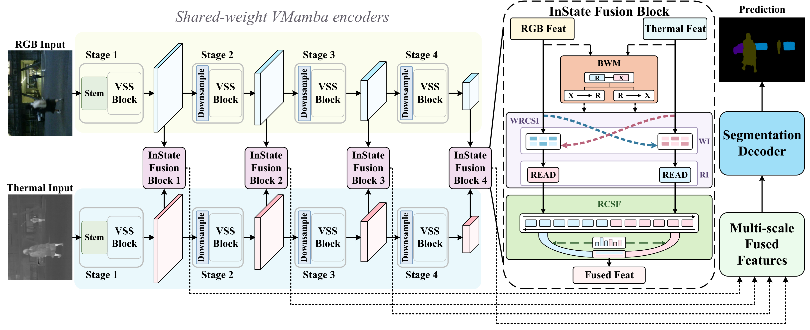

# InState-Mamba

**Multimodal semantic segmentation with write-read coupled state interaction.**

This initial code release provides the model implementation, dataset resources, training splits, and training/evaluation scripts. The manuscript has not yet been published; publication details will be added when available.

<p align="center">
  <a href="#overview">Overview</a> ·
  <a href="#datasets">Datasets</a> ·
  <a href="#installation">Installation</a> ·
  <a href="#training">Training</a> ·
  <a href="#evaluation">Evaluation</a> ·
  <a href="#license">License</a>
</p>

## Overview



InState-Mamba extracts RGB and thermal features with a shared-weight VMamba encoder, performs cross-modal interaction and fusion at four feature levels, and predicts semantic labels with a segmentation decoder. Each InState Fusion Block combines **WRCSI**, **BWM**, and **RCSF**. WRCSI and BWM are separate components that cooperate at the state WRITE interface; RCSF fuses the interacted responses.

[View the vector figure](assets/overview.pdf) · [Figure copyright and permissions](assets/README.md)

## Datasets

Download the processed datasets used by this implementation.

| Dataset | Download | Extraction code | Original dataset |
| --- | --- | --- | --- |
| **MFNet** | [Baidu Netdisk](https://pan.baidu.com/s/14690TaddWwEpWrhPko54yQ?pwd=bd34) | `bd34` | [MFNet](https://github.com/haqishen/MFNet-pytorch) |
| **PST900** | [Baidu Netdisk](https://pan.baidu.com/s/10slEguVob8xaT_KtapwrrQ?pwd=cxvx) | `cxvx` | [PST900](https://github.com/ShreyasSkandanS/pst900_thermal_rgb) |
| **NYU Depth V2** | [Baidu Netdisk](https://pan.baidu.com/s/1nZ5Q8dUjdlrmMuFj2Qecbg?pwd=8ad9) | `8ad9` | [NYU Depth V2](https://cs.nyu.edu/~silberman/datasets/nyu_depth_v2.html) |

### Data layout

Extract the archives into `datasets/`, or set the corresponding environment variables below. Select the inner directory if an archive creates an extra wrapper folder.

```text
datasets/
├── MFNet/
│   ├── RGB/
│   ├── Modal/
│   └── Label/
├── PST900_RGBT_Dataset/
│   ├── RGB_resize/
│   ├── thermal_resize/
│   ├── labels_resize/
│   ├── train.txt
│   └── test.txt
└── NYUDepthv2/
    ├── RGB/
    ├── Depth/
    ├── Label/
    ├── train2.txt
    └── test2.txt
```

For datasets stored elsewhere:

```bash
export MFNET_ROOT=/path/to/MFNet
export PST900_ROOT=/path/to/PST900_RGBT_Dataset
export NYU_ROOT=/path/to/NYUDepthv2
```

Keep the supplied processed images, filenames and label IDs. Dataset usage follows the original providers' terms.

### Training and test splits

| Dataset | Training list | Evaluation list | Location |
| --- | --- | --- | --- |
| MFNet | [train2.txt](splits/MFNet/train2.txt), 1,176 samples | [test.txt](splits/MFNet/test.txt), 393 samples | Included in this repository |
| PST900 | `train.txt` | `test.txt` | Inside the dataset archive |
| NYU Depth V2 | `train2.txt` | `test2.txt` | Inside the dataset archive |

MFNet also includes [daytime](splits/MFNet/test_day.txt) (205 samples) and [nighttime](splits/MFNet/test_night.txt) (188 samples) test lists. They are disjoint and together cover the full test set. Training and test lists do not overlap.

Each list contains one sample ID per line, without the `.png` extension. MFNet reads the repository lists directly; it does not require copying them into the dataset directory.

## Installation

Use **Linux**, an NVIDIA GPU, a **CUDA 11.8 toolkit** with `nvcc`, and a compatible C++ compiler. The reference server uses Python 3.9.25, PyTorch 2.0.1+cu118, torchvision 0.15.2+cu118, GCC 11.4.0, and two RTX 4090 GPUs (24 GB each).

After downloading the source code, open a terminal at the repository root:

```bash
conda create -n dwr-mamba python=3.9 -y
conda activate dwr-mamba

python -m pip install torch==2.0.1 torchvision==0.15.2 --index-url https://download.pytorch.org/whl/cu118
python -m pip install -r requirements.txt
python -m pip install --no-build-isolation ./models/encoders/selective_scan
```

Check the required CUDA extension:

```bash
python -c "import torch, selective_scan, selective_scan_cuda_core; print('PyTorch:', torch.__version__); print('CUDA available:', torch.cuda.is_available())"
```

### Backbone initialization weights

For training, download the initialization file matching the configured backbone and put it under `pretrained/vmamba/`.

| Backbone | Initialization file | Download |
| --- | --- | --- |
| VMamba-T | `vssmtiny_dp01_ckpt_epoch_292.pth` | [Google Drive](https://drive.google.com/file/d/1W0EFQHvX4Cl6krsAwzlR-VKqQxfWEdM8/view) |
| VMamba-S | `vssmsmall_dp03_ckpt_epoch_238.pth` | [Google Drive](https://drive.google.com/file/d/1671QXJ-faiNX4cYUlXxf8kCpAjeA4Oah/view) |

These are the initialization files linked by [Sigma](https://github.com/zifuwan/Sigma#training). Evaluation of a complete trained InState-Mamba checkpoint does not require separate initialization weights.

## Training

| Dataset argument | Configuration | Default model | Output directory |
| --- | --- | --- | --- |
| `mfnet` | [config_MFNet.py](configs/config_MFNet.py) | InState-Mamba-T | `runs/mfnet/dwr_tiny/` |
| `pst` | [config_pst900.py](configs/config_pst900.py) | InState-Mamba-T | `runs/pst900/dwr_tiny/` |
| `nyu` | [config_nyu.py](configs/config_nyu.py) | InState-Mamba-S | `runs/nyu/dwr_small/` |

The implementation keeps the existing `dwr_tiny` and `dwr_small` identifiers. All three configurations enable the full model: WI, RI, BWM, RCSF and its three branches, with `bwm_mode='full'`. The `legacy` configuration value preserves the original naming; it does not disable any component.

The original two-GPU MFNet command is:

```bash
CUDA_VISIBLE_DEVICES=0,1 python -m torch.distributed.launch --nproc_per_node=2 --master_port=16005 train.py --dataset_name mfnet
```

Equivalent wrappers are provided for all three datasets:

```bash
bash scripts/train.sh mfnet
bash scripts/train.sh pst
bash scripts/train.sh nyu
```

To use another GPU pair or port:

```bash
CUDA_VISIBLE_DEVICES=2,3 MASTER_PORT=16006 bash scripts/train.sh mfnet
```

Run commands from the repository root after setting the data paths and downloading the matching initialization weights. The configurations retain the training hyperparameters; the reference training setup uses two GPUs.

## Evaluation

Use a checkpoint produced by training, passing its actual path:

```bash
bash scripts/eval.sh mfnet /path/to/mfnet-checkpoint.pth
bash scripts/eval.sh pst /path/to/pst900-checkpoint.pth
bash scripts/eval.sh nyu /path/to/nyu-checkpoint.pth
```

The equivalent MFNet command is:

```bash
CUDA_VISIBLE_DEVICES=0 python eval.py --dataset_name mfnet -d 0 -e /path/to/mfnet-checkpoint.pth
```

To also save prediction masks:

```bash
bash scripts/eval.sh mfnet /path/to/mfnet-checkpoint.pth --save_path outputs/mfnet
```

| Dataset | Evaluation scales | Horizontal flip | Crop size |
| --- | --- | --- | --- |
| MFNet | 1.0 | No | 480 × 640 |
| PST900 | 1.0 | No | 720 × 1280 |
| NYU Depth V2 | 0.75, 1.0, 1.25 | Yes | 480 × 640 |

MFNet mIoU averages all nine classes, including `unlabeled`; label 255 is ignored. Use the supplied splits and evaluation settings when reproducing results.

Trained segmentation checkpoints are not hosted with this initial code release. The source includes the full training and checkpoint-evaluation workflow.

## Code structure

```text
assets/        Model overview
configs/       Dataset settings and model configurations
models/        Encoder, fusion modules, decoder and CUDA scan source
dataloader/    Paired data loading and preprocessing
engine/        Training and evaluation infrastructure
utils/         Core helpers
splits/MFNet/  Training, test, daytime and nighttime lists
scripts/       Training and evaluation launchers
pretrained/    Backbone initialization files (download separately)
checkpoints/   Trained checkpoints (excluded from Git)
train.py       Training entry point
eval.py        Evaluation entry point
```

## Acknowledgements

We thank [Sigma](https://github.com/zifuwan/Sigma), [VMamba](https://github.com/MzeroMiko/VMamba), [Mamba](https://github.com/state-spaces/mamba), and [CMX](https://github.com/huaaaliu/RGBX_Semantic_Segmentation) for their open-source implementations.

## License

InState-Mamba's original code contributions and documentation are released under the [MIT License](LICENSE), copyright (c) 2026 Xinwei Zhang. The original Sigma copyright notice is retained.

Third-party components retain their respective licenses and copyright notices; see [Third-party notices](THIRD_PARTY_NOTICES.md). The MIT license for InState-Mamba contributions does not replace those terms.

The overview figure is copyright (c) 2026 Xinwei Zhang and is covered by a [separate figure notice](assets/README.md), rather than the code's MIT license. Datasets and downloaded pretrained weights remain subject to their original providers' terms and are not licensed by this repository.
